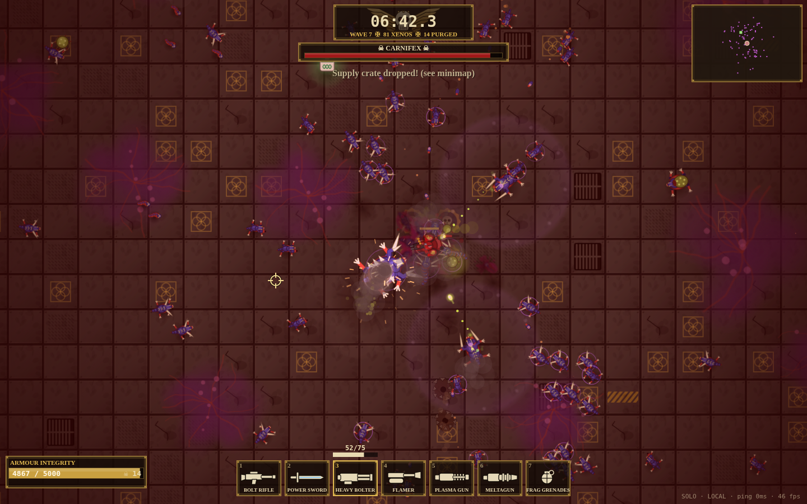
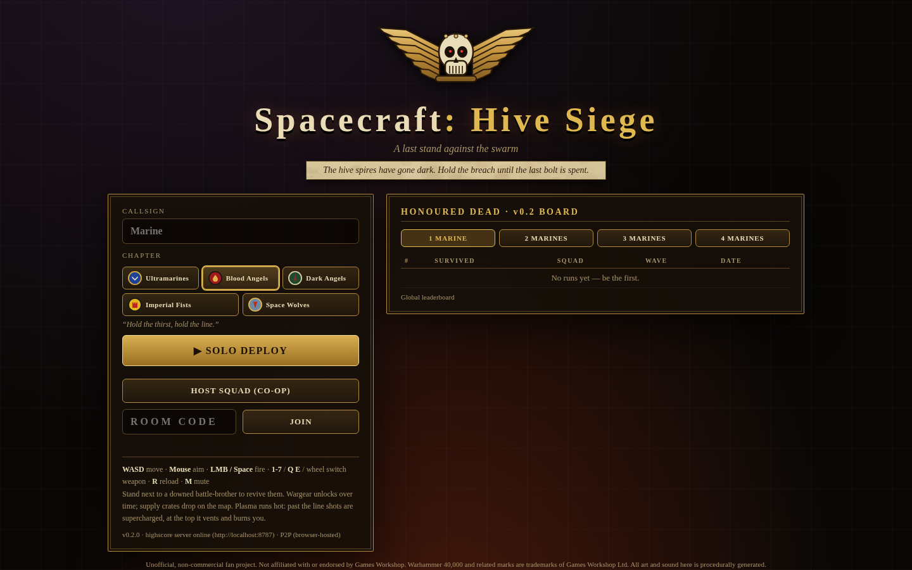
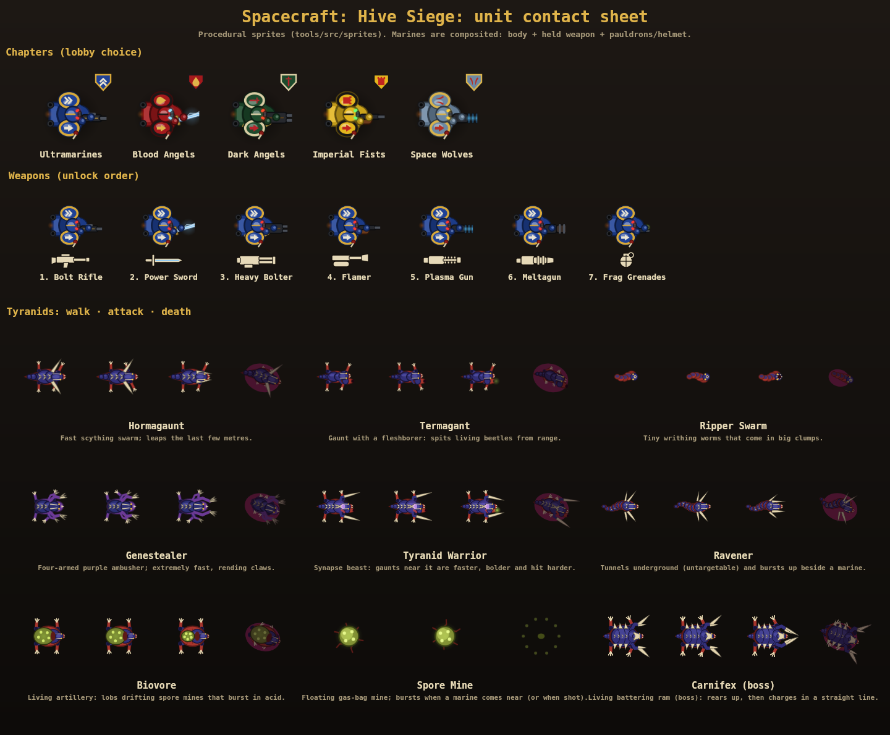
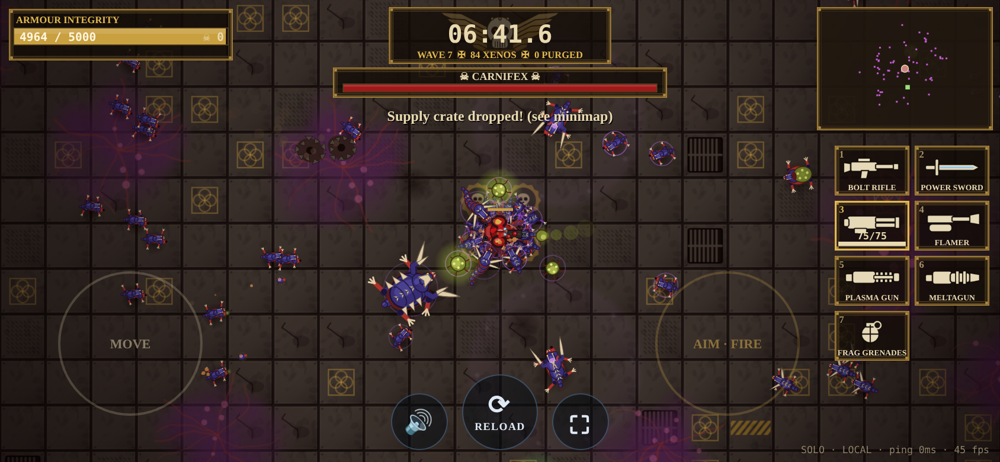
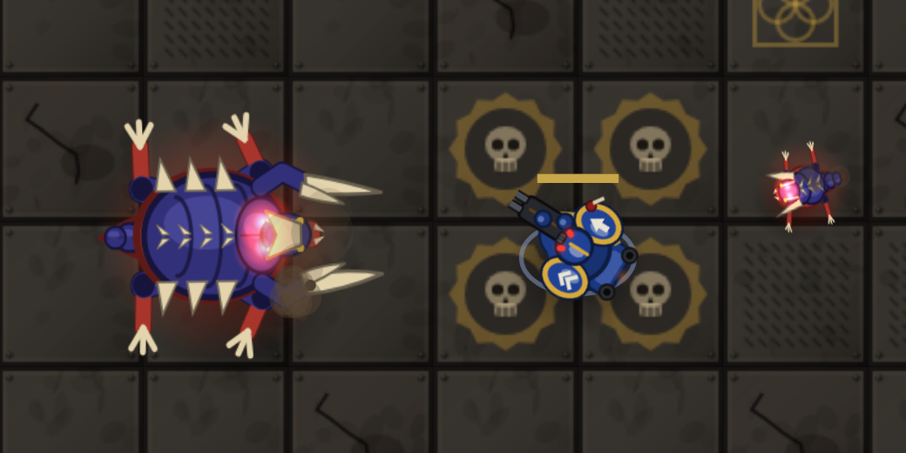
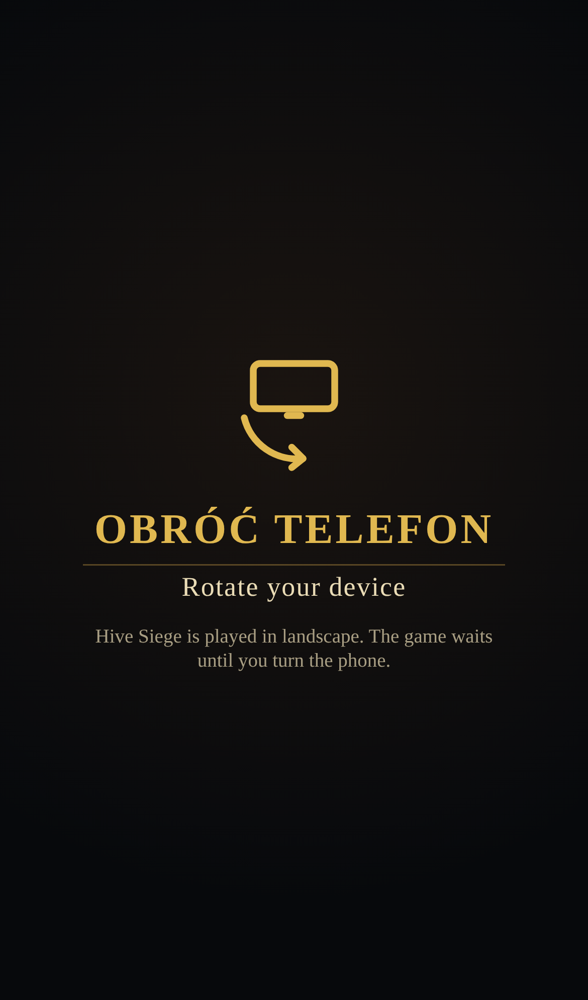
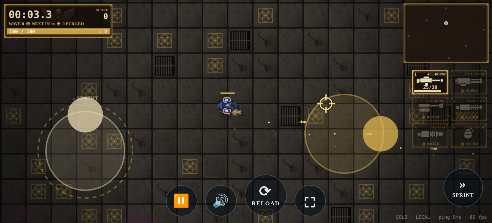

# Spacecraft: Hive Siege

> **Unofficial fan project.** This is a free, non-commercial fan game. It is **not affiliated with,
> endorsed by or sponsored by Games Workshop**. Warhammer, Warhammer 40,000, Space Marine,
> Tyranid, chapter names and all associated marks are trademarks of **Games Workshop Ltd**. The
> repository contains no Games Workshop artwork, logos, text or sounds. Every sprite, icon, emblem,
> sound and music track is generated procedurally by our own code. All in-game names live in
> content data and can be swapped for neutral ones (`?names=generic`, see "Renaming").

Top-down co-op swarm survival for the browser, styled after Warhammer 40,000 tabletop. A squad of
**1-8 Primaris-style battle-brothers** holds a ruined hive city against the **Tyranid** swarm in
Behemoth colours. The swarm comes in **finite waves** that pour out of marked hive breaches; clear
a wave to earn a breather, and a **Carnifex** leads every 3rd wave. Wargear unlocks as you survive.
Squads are ranked by **survival time** (one table per team size, 1-8), and every marine also
earns **personal points** for kills, ranked on an individual leaderboard. Each game version
(major.minor) has its own leaderboards.

**Play it:** https://fafa87.github.io/spacecraft/ (latest). Frozen older builds:
https://fafa87.github.io/spacecraft/v0.1.0/, https://fafa87.github.io/spacecraft/v0.2.0/ and the menu's **Previous versions** link. It is a
static GitHub Pages build: a global leaderboard in Firestore with a local fallback, and P2P co-op
through the public PeerJS broker.



| Menu (chapter picker)     | Units (procedural sprites)      | Phone (touch twin-stick)      |
| ------------------------- | ------------------------------- | ----------------------------- |
|  |  |  |

**Sound and the leap telegraph (v0.3).** Every sound is layered procedural DSP in a 40k register
(boom, sub thump, noise body, mechanical rattle, corridor reverb, saturation): listen to the
32-second scripted mix in [docs/audio-preview.mp3](docs/audio-preview.mp3) (lossless:
[docs/audio-preview.wav](docs/audio-preview.wav)). Leapers no longer draw a red lane: you see the
creature gather itself. The Hormagaunt crouches, pulls back, trembles and its eyes flare; the
Carnifex rears up, paws the deck and roars before it charges.



## The forces

**Battle-brothers.** Primaris Intercessor-style marines with big rounded pauldrons, a grille
helm and a backpack. Pick a chapter in the menu or the lobby; each player in a squad has a
different one. Shoulder badges are simple geometric shapes of our own, not chapter logos.

| Chapter        | Armour / trim    | Badge   |
| -------------- | ---------------- | ------- |
| Ultramarines   | blue / gold      | chevron |
| Blood Angels   | red / black      | drop    |
| Dark Angels    | green / bone     | blade   |
| Imperial Fists | yellow / black   | tower   |
| Space Wolves   | grey-blue / gold | fang    |
| Salamanders    | green / black    | flame   |
| White Scars    | bone / red       | bolt    |
| Raven Guard    | black / white    | feather |

There are as many chapters as squad slots (`MAX_PLAYERS` = 8; content validation fails if a
chapter is missing), so every marine of a full squad has its own colours.

**Wargear** (keys 1-6, the wheel or Q/E; unlocks over survival time, also found in supply crates):

| #   | Weapon        | Unlocks | Play                                                                                                                    |
| --- | ------------- | ------- | ----------------------------------------------------------------------------------------------------------------------- |
| 1   | Bolt Rifle    | 0:00    | Reliable mass-reactive bolts that burst on impact                                                                       |
| 2   | Heavy Bolter  | 1:00    | Belt-fed explosive bolts; slows you down. **Brace**: stand still for 0.25 s and it fires 70% faster with a tighter cone |
| 3   | Flamer        | 2:05    | Short promethium cone that melts swarms                                                                                 |
| 4   | Plasma Gun    | 3:20    | Piercing shots. Shots past the heat line are **supercharged**; a full gauge **overheats**: it vents and burns you       |
| 5   | Meltagun      | 4:45    | Short-range thermal lance for bosses                                                                                    |
| 6   | Frag Grenades | 6:10    | Lobbed blast charges                                                                                                    |

The Power Sword was removed in v0.4.

**Weapon profiles (v0.5).** Damage works like Warhammer 40k: every weapon has a Strength and
AP, every Tyranid a Toughness and an armour Save. Strength vs Toughness scales the damage, and a
made save stops the hit completely (a carapace ricochet and sparks, no damage). Each weapon
shows its role in the HUD and on pickup: Bolt Rifle **ALL-ROUND** (S4 AP-1), Heavy Bolter and
Flamer **ANTI-HORDE**, Plasma Gun **ANTI-ELITE** (S7 AP-2), Meltagun **ANTI-TANK** (S9 AP-4,
the way to kill a Carnifex), Frag Grenades **ANTI-HORDE** blasts. Marines move slower while
firing (heavy bolter the most) and regain full speed 0.35 s after letting go. Waves scale with
squad size 1-8: more and faster spawns, tougher Tyranids and more elites for bigger squads. Full
tables: [docs/ADDING_CONTENT.md](docs/ADDING_CONTENT.md).

**The swarm** (Behemoth-style palette: deep blue-purple carapace, red flesh, bone talons and yellow eyes; Genestealers in purple):

| Tyranid         | Role                                                                                       |
| --------------- | ------------------------------------------------------------------------------------------ |
| Hormagaunt      | fast melee swarm; leaps the last metres                                                    |
| Termagant       | ranged gaunt spitting fleshborer beetles                                                   |
| Ripper Swarm    | tiny worms in big clumps                                                                   |
| Genestealer     | four-armed, purple, very fast                                                              |
| Tyranid Warrior | **synapse**: nearby gaunts are faster and hit harder (violet halo)                         |
| Ravener         | **burrows** (untargetable dust trail) and erupts beside a marine                           |
| Biovore         | living artillery that lobs drifting spore mines                                            |
| Spore Mine      | floating gas-bag; bursts in acid near marines or when shot                                 |
| Carnifex        | **boss**: rears up, then charges in a straight line. Leads wave 3 and every 3rd wave after |

**Waves, spawn points and scoring (v0.4).**

- **Finite waves.** Each wave has a fixed, data-driven enemy budget
  (`DIRECTOR.waves.budget`, scaled by team size 1-8 through `DIRECTOR.teamScaling`: more and faster spawns, tougher and
  more elite Tyranids for bigger squads). The next wave starts
  only after the whole wave is dead, children included (Biovore spore mines are capped and
  finite). Then comes an 8 s breather with **WAVE N CLEARED** and a countdown. The HUD shows how
  many Tyranids are left. Stragglers can't stall a run: when only a few are left (or after 30 s)
  they hunt the squad faster (no markers or arrows point at them), and a wave is forced on after
  240 s.
  Medkit and crate drops are capped per wave (scaled by squad size), and children never drop.
- **Spawn points.** Tyranids pour out of six fixed hive breaches (four bulkheads at the arena
  edges, two floor vents), drawn as plain holes and vents on the floor and as dim dots on the
  minimap. Nothing warns where the next group comes from: no pulse, no edge arrows, no labels.
  The director still waits 1.1 s (2.2 s for a boss) before a group emerges, and spawns avoid
  breaches right next to a marine.
- **Personal points.** Every kill gives its marine the enemy's `points` (Hormagaunt 2,
  Termagant 3, Ripper 1, Genestealer 5, Warrior 15, Ravener 10, Biovore 8, Spore Mine 1,
  Carnifex 50). The HUD shows each marine's points. The game-over screen breaks the squad down
  (points and share, kills, top kills by type, damage, when they fell, the MVP) and the
  leaderboards have a **MARINES · POINTS** board: all team sizes or one at a time.
- **Downed marines** bleed out after **60 s** (was 20 s before v0.4); a revive still takes 3 s
  next to them.
- **Units above terrain.** Ruins and debris are drawn under every marine, Tyranid and
  projectile, so nothing hides behind scenery.
- **Escape / ⏸** opens a "leave the game?" dialog. Solo play pauses while it is open; in a squad
  the game keeps running (the dialog says so), and a leaving host closes the room as before.
- **Music** is Chaos Gate-style gothic: organ, choir, bells and war drums. A combat drive layer
  swells with the size of the swarm and falls silent between waves, a boss track takes over while
  a Carnifex is on the field, and a sting plays when a wave is cleared.

All stats live in `packages/shared/src/data/` (`weapons.ts`, `enemies.ts`, `director.ts`,
`chapters.ts`, `naming.ts`); see [docs/ADDING_CONTENT.md](docs/ADDING_CONTENT.md).

### Renaming (IP-neutral names)

Every displayed name (title, subtitle, weapons, enemies and chapters) comes from content
data. `NAME_PRESETS` in `packages/shared/src/data/naming.ts` overrides them by id, and ids (saves,
the wire format, assets) never change. Pick a preset with `?names=generic` or at build time with
`VITE_NAMES=generic`. The `generic` preset replaces every Games Workshop term (Burst Rifle,
Slasher, Stalker…). Add your own preset in the same file.

## Quick start

Requirements: Node ≥ 20 and npm ≥ 10.

```bash
npm install
npm run assets      # generate sprites/atlas, SFX, music + manifest (also runs before dev/build)
npm run dev         # highscore server + Vite client (see ports below)
```

Then open **http://localhost:5173**, enter a name and choose **Solo**, **Host co-op** or **Join**.

| Service                      | URL / port                                          | What it does                                      |
| ---------------------------- | --------------------------------------------------- | ------------------------------------------------- |
| Client (Vite)                | http://localhost:5173                               | The game                                          |
| Highscore API (Fastify)      | http://localhost:8787/api                           | `/api/highscores`, `/api/health`, `/api/config`   |
| PeerJS signaling             | :9000 at `/peerjs`                                  | WebRTC matchmaking for P2P co-op                  |
| Dedicated WS host (optional) | ws://localhost:8787/ws                              | Server-hosted rooms (`?ws=1` in the client)       |
| Asset preview                | http://localhost:5173/assets/generated/preview.html | Contact sheet of every generated sprite and sound |

### Controls

The client detects the input device by itself. A touch puts it in touch mode, and mouse
movement or a key press puts it back in keyboard/mouse mode, so a touchscreen laptop works both
ways. The PC controls are unchanged.

**PC (keyboard + mouse)**

- **WASD / arrow keys:** move.
- **Mouse:** aim.
- **Left mouse button:** fire.
- **R:** reload.
- **1-6, mouse wheel or Q/E:** switch weapon.
- **Esc:** "leave the game?" dialog (pauses solo play).
- **M:** mute. Per-bus volumes (master, weapons, Tyranids, ambience, interface, music) are in
  the menu under **SOUND MIX** and are remembered in this browser.
- **Revive:** stand next to a downed teammate for 3 seconds (they bleed out after 60 s).
- **Heavy Bolter brace:** stop moving to plant your feet; it fires faster.

**Phone / tablet (standard twin-stick)**

- **Left half of the screen:** a floating **move stick**. It appears where your thumb lands and
  follows it if you drag past the edge. The deadzone is 12% and the speed is analog.
- **Right half of the screen:** a floating **aim stick**. It aims in the direction you push
  and **auto-fires** once it is past a 20% deadzone. Let go to stop firing. While you only move,
  the marine faces the way it is walking.
- **Weapon slots** (right edge): tap an unlocked slot to switch to it.
- **Bottom buttons:** ⟳ reload (large), 🔊 mute, ⏸ leave dialog and ⛶ fullscreen (fullscreen also locks
  landscape where the browser allows it).
- **Multi-touch** works: move, aim and tap buttons at the same time. Page scroll, pinch-zoom,
  pull-to-refresh and long-press menus are disabled in game.
- **Orientation:** phones play in **landscape**. The first button tap (Solo, Host, Join…) asks for
  fullscreen and `screen.orientation.lock('landscape')`, which works on Android Chrome. The web
  manifest also declares `"orientation": "landscape"` for home-screen installs. When a phone is
  still held in portrait (iOS Safari cannot lock), a full-screen **"Obróć telefon / Rotate your
  device"** overlay covers the page. Input is ignored and a solo run pauses until the phone is
  turned. Tapping the overlay retries the lock. Tablets and PC are not affected. The HUD scales
  down on small screens and respects notches and safe areas.




### Joining from a phone (QR code)

The co-op lobby (**Host co-op**) shows a **QR code**, the room code, the join link and a
**Copy link** button. Scanning the QR opens `<site>/?join=CODE`, which goes straight to a short
join screen. That screen only asks for a callsign, which is prefilled from your last visit. If
the join fails, the error is shown on that screen so you can retry.
The link respects the deploy base path (e.g. `/spacecraft/`) and keeps `?ws=1` / `?api=`.

**Testing on a phone over LAN in dev:** the QR uses the address the _host_ browser was opened
with, so do not open the host on `localhost`.

`npm run dev` already serves the client on all interfaces (`vite --host 0.0.0.0`; for a plain
Vite setup this is `vite --host`). Open `http://<your-LAN-IP>:5173` on the PC (e.g. `http://192.168.1.20:5173`) and host a room,
then scan the QR with a phone on the same Wi-Fi. For P2P co-op in dev, the PeerJS signaling
server (:9000) must also be reachable from the phone. The deployed GitHub Pages build uses the
public PeerJS cloud for signaling.

### Phones on mobile data (TURN relay)

WebRTC connects the two browsers directly, using STUN to find each side's public address. That
works on Wi-Fi and most home networks, but **when both phones are on cellular data** the
carriers' CGNAT / symmetric NAT usually blocks a direct path. The only fix is a **TURN relay**
that forwards the traffic. PeerJS's old built-in relay (`turn.peerjs.com`) is gone, so the game
ships STUN-only unless a TURN server is configured at build time (see `.env.example`):

- `VITE_TURN_CREDENTIALS_URL`: a URL that returns an ICE-server array, fetched at join/host
  time with a 4 s timeout, e.g. Metered's
  `https://<app>.metered.live/api/v1/turn/credentials?apiKey=<key>`; or
- `VITE_TURN_URLS` (comma-separated) + `VITE_TURN_USERNAME` + `VITE_TURN_CREDENTIAL`, e.g.
  `turn:global.relay.metered.ca:80,turn:global.relay.metered.ca:80?transport=tcp,turn:global.relay.metered.ca:443,turns:global.relay.metered.ca:443?transport=tcp`
  (UDP, TCP and TLS on 443 for strict carriers); or
- `VITE_ICE_SERVERS`: a full JSON `RTCIceServer[]`.

TURN credentials end up in the public JS bundle (any browser-side TURN config does), so use a
quota-limited relay account. Without TURN, a failed join tells players to put both phones on the
same Wi-Fi or use a hotspot.

### iPhone: full screen

Safari on iPhone has no fullscreen for web pages (Android goes fullscreen + landscape on the first
tap). The game shows a one-time Polish hint: **Udostępnij → „Do ekranu początkowego”**. Launched
from that home-screen icon, the game runs without Safari's bars (manifest + apple meta tags,
`start_url` "." so each `/vX.Y.Z/` installs that version). The hint is not shown again after
dismissal (`sms.iosHint.dismissed` in localStorage) or inside the installed app.

### Client URL parameters

- `?api=http://host:8787` overrides the highscore server.
- `?join=CODE` opens the quick-join screen for that room (this is what the lobby QR encodes).
- `?ws=1` uses the dedicated WebSocket host instead of P2P.
- `?debug=1` (or F3 in game) shows the net/debug overlay.
- `?autosolo=1&name=X` starts a solo run straight away (used by the smoke test).
- `?names=generic` uses a display-name preset (see "Renaming").
- `?demo=hive` starts a solo showcase: a staged late-game fight with every Tyranid type, all
  wargear and a sturdy marine. Nothing is submitted (used for screenshots).
- `?firestore=0` turns the Firestore leaderboard off (local scores only), for tests.
- `?relay=1` forces WebRTC through the TURN relay only (`iceTransportPolicy: 'relay'`), to
  prove the relay works: with no working TURN the join fails.
- `?turnApi=<url>` uses that TURN credentials URL for this session (overrides
  `VITE_TURN_CREDENTIALS_URL`), to try a relay without rebuilding.

## Commands

| Command                               | Description                                                                                                                                    |
| ------------------------------------- | ---------------------------------------------------------------------------------------------------------------------------------------------- |
| `npm run dev`                         | Runs the server (tsx watch) and client (Vite) together, after `assets`.                                                                        |
| `npm run assets`                      | Procedural asset generation → `packages/client/public/assets/generated/`.                                                                      |
| `npm test`                            | Vitest (shared sim/session/validation, server API + repos, client netcode/highscore stores, tools).                                            |
| `npm run lint` / `npm run format`     | ESLint (typescript-eslint) / Prettier.                                                                                                         |
| `npm run typecheck`                   | `tsc` for every package.                                                                                                                       |
| `npm run build`                       | Typecheck, then server bundle (`tsup` → `packages/server/dist`) and client bundle (`vite` → `packages/client/dist`).                           |
| `npm start`                           | Runs the built server.                                                                                                                         |
| `npm run smoke`                       | Headless end-to-end check: real server, two WS clients, server-side run submit, POST/GET highscores, a full headless solo run.                 |
| `npm run smoke:browser`               | Headless Chrome against the running Vite client: menu, solo run, host submit to its own in-memory API, P2P + WS co-op, screenshots in `docs/`. |
| `npm run rules`                       | Regenerates `firestore.rules` from the shared limits and name rules (a test fails if it is stale).                                             |
| `npm run test:rules`                  | Firestore security-rules tests in the emulator (needs Java 11+), including the REST store end to end.                                          |
| `npm run check:firestore`             | Live smoke test against the configured Firebase project: create, read, query, duplicate and invalid writes.                                    |
| `npm run sim -- --bot=kite --seeds=6` | Headless balance simulation: bot survival statistics per team size.                                                                            |
| `npm run net:load`                    | Network load probe: 8 bot clients in a heavy late wave; host upload per client and total, snapshot size, JSON vs protocol v5.                  |
| `npm run contact-sheet -w @sms/tools` | Renders the labelled unit sheet `docs/wh-sprites.png` from the generated atlas.                                                                |
| `npm run audio-preview -w @sms/tools` | Renders the 32 s scripted sound showcase to `docs/audio-preview.wav` and `.mp3` (ffmpeg).                                                      |
| `npm run deploy:pages [-- --push]`    | Versioned GitHub Pages deploy: latest at `/`, frozen `/vX.Y.Z/`, updated `versions.json`; a normal commit on `gh-pages`, never forced.         |

### Server configuration (env vars)

| Var                                            | Default                         |                                                             |
| ---------------------------------------------- | ------------------------------- | ----------------------------------------------------------- |
| `HOST` / `PORT`                                | `0.0.0.0` / `8787`              | HTTP listen address                                         |
| `HIGHSCORE_STORE`                              | `sqlite`                        | `sqlite` (sql.js/WASM, no native build), `json` or `memory` |
| `DATA_DIR`                                     | `./data` (in `packages/server`) | Where `highscores.sqlite` / `highscores.json` live          |
| `CORS_ORIGIN`                                  | `*`                             | Comma-separated list of allowed origins                     |
| `SUBMIT_RATE_PER_MINUTE`                       | `20`                            | POSTs per IP per minute (0 = unlimited)                     |
| `PEER_PORT` / `PEER_PATH` / `PEER_PUBLIC_HOST` | `9000` / `/peerjs` / page host  | Bundled PeerJS server (`PEER_PORT=0` disables it)           |
| `WS_GAME_HOST`                                 | `true`                          | Enables the dedicated WebSocket game host at `/ws`          |
| `LOG_LEVEL`                                    | `info`                          | pino level, or `silent`                                     |

Client build-time env:

| Variable                                                                                                            | Default                                                 | Meaning                                                                                                                              |
| ------------------------------------------------------------------------------------------------------------------- | ------------------------------------------------------- | ------------------------------------------------------------------------------------------------------------------------------------ |
| `BASE_PATH`                                                                                                         | `/`                                                     | Public base path (Vite `base`), e.g. `/spacecraft/` for GitHub Pages                                                                 |
| `VITE_HIGHSCORE_URL`                                                                                                | dev: `http://<page host>:8787`; prod: none              | Highscore server. With none set, a production build uses local (browser) highscores quietly and hides the dedicated WS host          |
| `VITE_FIREBASE_API_KEY` / `VITE_FIREBASE_PROJECT_ID`                                                                | `.env.production`: project `spacecraft-5f703`           | Firestore global leaderboard (see "Highscores with Firebase"). Takes priority over `VITE_HIGHSCORE_URL`; `?firestore=0` turns it off |
| `VITE_FIRESTORE_URL`                                                                                                | `https://firestore.googleapis.com/v1`                   | Firestore REST base, e.g. `http://127.0.0.1:8080/v1` for the emulator                                                                |
| `VITE_PEER_HOST` / `VITE_PEER_PORT` / `VITE_PEER_PATH` / `VITE_PEER_SECURE`                                         | dev: local server via `/api/config`; prod: PeerJS cloud | PeerJS signaling server                                                                                                              |
| `VITE_TURN_CREDENTIALS_URL` / `VITE_TURN_URLS` + `VITE_TURN_USERNAME` + `VITE_TURN_CREDENTIAL` / `VITE_ICE_SERVERS` | none (STUN only)                                        | TURN relay for players on mobile data (see "Phones on mobile data")                                                                  |

## Versions, releases and deploy (GitHub Pages)

The site is served from the **`gh-pages` branch** (Pages source "Deploy from a branch", root):

```
/spacecraft/                 latest release (built with BASE_PATH=/spacecraft/)
/spacecraft/v0.1.0/          frozen v0.1.0 (BASE_PATH=/spacecraft/v0.1.0/)
/spacecraft/v0.2.0/          frozen v0.2.0
/spacecraft/v0.3.0/          frozen v0.3.0
/spacecraft/v0.4.0/          frozen v0.4.0
/spacecraft/v0.4.1/          frozen v0.4.1
/spacecraft/v0.4.2/          frozen v0.4.2
/spacecraft/v0.5.0/          frozen v0.5.0
/spacecraft/v0.5.1/          frozen v0.5.1 …
/spacecraft/versions.json    {"latest":"0.5.1","versions":[{"version","date","title","path"}…]} (newest first)
```

The menu's **Previous versions** link reads `versions.json` from the site root (a frozen build
finds it by stripping its own `vX.Y.Z/` from the base URL) and is hidden when the list can't be
loaded. Each version keeps its own localStorage highscore table and its own Firestore board (see
"Per-version boards"), so old builds keep working unchanged.

**Release checklist**

1. Bump `GAME_VERSION` in `packages/shared/src/constants.ts` (and the `version` in the
   `package.json` files). Since v0.5.1 **every release** (patch included) starts a **new, empty
   leaderboard** (`boards/<version>`). If the board pattern changes, re-publish `firestore.rules`.
2. Run `npm run lint && npm run typecheck && npm test` (plus `npm run test:rules` when rules
   changed). Then commit and push `master` (never force).
3. Tag and release, targeting the exact commit:
   ```bash
   git tag -a v0.5.1 -m "v0.5.1: full kill summary" && git push origin v0.5.1
   gh release create v0.5.1 --target "$(git rev-parse HEAD)" --title "v0.5.1 · Hive Siege" --notes-file notes.md
   ```
4. Deploy: `npm run deploy:pages` builds the current checkout twice (into `/` and
   `/v<GAME_VERSION>/`) and adds a worktree of `origin/gh-pages`. In it, it replaces only the root
   files and this version's folder, keeps every other `vX.Y.Z/`, upserts `versions.json` and
   commits. Inspect the result, then run `npm run deploy:pages -- --push`. The push is a plain
   `git push origin HEAD:gh-pages`. It is **never forced**: if it is rejected, re-run the script.
   - Options: `--title "…"` and `--add <ver>=<distDir>[=<title>]` to install a prebuilt frozen
     build. Example: v0.1.0 was built from tag `v0.1.0` in a worktree
     (`git worktree add /tmp/v010 v0.1.0 && cd /tmp/v010 && npm ci && BASE_PATH=/spacecraft/v0.1.0/ npm run build:pages`),
     then installed with `--add 0.1.0=/tmp/v010/packages/client/dist`.
5. Check it live: `npx tsx scripts/pages-check.ts https://fafa87.github.io/spacecraft/` (also run
   it on `/v0.1.0/`, `/v0.2.0/`, `/v0.3.0/`, `/v0.4.0/`, `/v0.4.1/`, `/v0.4.2/`, `/v0.5.0/` and `/v0.5.1/`). It checks the menu, assets under the base path, local scores,
   a P2P room, a solo run and the console.

CI option: a `pages.yml` workflow that runs the same steps on `v*` tags
(`npm ci`, assets, tests, `npm run deploy:pages -- --push` with `contents: write`) is kept on a
local branch and not pushed yet. Repository variables `FIREBASE_API_KEY` / `FIREBASE_PROJECT_ID`
override the defaults from `.env.production`, and `HIGHSCORE_URL` selects a hosted highscore
server (its `CORS_ORIGIN` must allow `https://<owner>.github.io`).

Locally, `npm run build:pages` builds with `/spacecraft/`.

## Repository layout

```
packages/
  shared/   @sms/shared: everything both sides must agree on (no DOM, no Node APIs)
    src/data/        content tables: weapons.ts, enemies.ts, director.ts, chapters.ts, naming.ts
                     (+ ContentRegistry & validation)
    src/sim/         deterministic simulation: world, systems/ (movement, weapons, projectiles,
                     enemies, director, combat, pickups, players), snapshot builder, spatial hash
    src/session/     HostSession (authoritative lobby + game loop), ClientSession, Scheduler
    src/net/         wire protocol, binary delta snapshot codec (wire.ts), Link abstraction +
                     in-memory LocalLink pair
    src/highscore/   RunResult/HighscoreEntry types, validation & plausibility checks
    src/assets/      asset manifest format + referencedAssetKeys(content)
  server/   @sms/server: Fastify highscore API, highscore repositories, PeerJS server, WS game host
  client/   @sms/client: Vite + Canvas2D (app/, game/, net/, render/, audio/, ui/, highscores/)
tools/      @sms/tools: procedural sprites → atlas, layered DSP SFX recipes, music, manifest, preview
scripts/    smoke.ts, browser-smoke.ts, mobile-check.ts, balance-sim.ts, net-load.ts, deploy-pages.ts,
            Firestore helpers
docs/       ARCHITECTURE.md, ADDING_CONTENT.md, ART_PIPELINE.md, screenshots
```

See **[docs/ARCHITECTURE.md](docs/ARCHITECTURE.md)** for the design in depth and
**[docs/ADDING_CONTENT.md](docs/ADDING_CONTENT.md)** for step-by-step guides to adding a weapon,
an enemy, a sprite, a sound or a music track. **[docs/ART_PIPELINE.md](docs/ART_PIPELINE.md)**
covers sprite sizes, animation frames and how to drop in your own art.

## How multiplayer works

- **Host-authoritative, transport-agnostic.**
  - One `HostSession` runs the simulation at a fixed **30 Hz**. It owns the lobby, applies the
    players' inputs, broadcasts snapshots and submits the result.
  - Clients are `ClientSession`s and only send inputs. Up to **8 marines** per session
    (`MAX_PLAYERS`).
  - Both talk through a tiny `Link` interface, so the same code runs over:
    - **LocalLink** (in-memory) for **solo**: the browser is host and client.
    - **PeerJS / WebRTC data channels** for **P2P co-op** (the default). The player who
      clicks _Host_ runs the `HostSession` in their tab and gets a 5-letter room code; the other
      players _Join_ with it. Signaling uses the bundled PeerJS server on :9000.
    - **WebSocket** to the **dedicated host** in the server (optional, `?ws=1`). The server
      runs the `HostSession`, which is the basis for server-authoritative anti-cheat.
- **Client prediction and reconciliation.** The local marine's movement is predicted with the
  same pure `stepPlayerMovement` the host uses. Unacknowledged inputs are replayed on each
  snapshot, and small errors are smoothed away.
- **Interpolation.** Other entities are rendered one snapshot interval + 1.5 ticks behind, from a
  `SnapshotBuffer` with a smoothed clock offset.
- **Bandwidth (protocol v5).** Network snapshots go out at **15 Hz** (the sim stays at 30 Hz;
  solo gets every tick) as **binary, per-link delta frames**: both ends extrapolate every entity
  and only corrections are sent, strings are sent once, and Tyranids far outside a client's view
  are refreshed every 4th snapshot. In a heavy wave-12 fight with 8 marines (about 93 Tyranids
  on the field, up to 152) this cut the host's upload from **12.9 Mbit/s** (v4 JSON at 30 Hz,
  P2P host + 7 remote marines) to **0.93 Mbit/s**. `npm run net:load` measures it; see
  docs/ARCHITECTURE.md "Bandwidth".
- **Team size** is the number of marines at the start of the run, and decides the highscore table.
  Downed marines can be revived; the run ends when no marine is left standing.

## How highscores work

> The GitHub Pages build stores scores in **Firestore** (next section). The flow below describes
> the self-hosted Fastify server, which is used when no Firebase config is set.

1. When a run ends, **only the host** builds a `RunResult`:
   `{ runId, teamSize, players[], survivalMs, kills, wave, endedAt, version, mode }`.
   Every client is told the outcome (`submitted` message → "rank #N on the global leaderboard").
2. The browser host POSTs it to `POST /api/highscores` through `FallbackHighscoreStore`:
   - Success: `201 { entry, rank, duplicate:false }`. `runId` is idempotent, so a re-submit
     returns `200 duplicate:true`.
   - **Server unreachable**: the run is saved in **localStorage** (status `local`) and
     re-submitted automatically the next time the server answers.
   - **Server rejects it** (4xx): reported as `failed`, so the run never pretends to have counted.
   - With the dedicated WS host, the **server itself** submits straight to the repository.
3. `GET /api/highscores?limit=10` returns all eight tables (team sizes 1-8). `GET /api/highscores/:teamSize?limit=N`
   (or `?teamSize=N`) returns one table, ordered by survival time (desc), earlier submission wins
   ties. `limit` is clamped to 1-100. `GET /api/scores?teamSize=N` (0 or none = all team sizes)
   returns the individual leaderboard by personal points.
4. Storage goes through the `HighscoreRepository` interface (`memory`, `json` and `sqlite`
   implementations; add Postgres etc. by implementing 5 methods).
5. **Validation and limits** (shared `validateRunResult`, also run by the client before sending):
   - team size 1-8, and `players.length === teamSize`;
   - optional `playerScores` / `playerKills` (v0.4+), one per marine, capped by survival time;
   - names sanitized to 1-16 characters, with control characters and `<>` stripped;
   - survival between 1 s and 4 h; `runId` pattern; mode whitelist; no future `endedAt`;
   - plausibility caps on kills per second per marine and on the wave number for the time
     survived;
   - 4 KB body limit, per-IP fixed-window rate limit (429), configurable CORS.

### Anti-cheat roadmap

Today the score is **trusted from the host browser**: validation only rejects nonsense and
implausible values, and a modified client can still submit a fake but plausible score. Planned
steps, roughly in order:

1. **Signed run tickets:** the server issues a `runId` + nonce at run start (`POST /api/runs`) and
   rejects submissions without a matching ticket, or whose duration disagrees with server
   wall-clock time.
2. **Server-authoritative runs:** the dedicated WS host already runs the same `HostSession`;
   mark scores from it as _verified_ and show them in their own table or with a badge.
3. **Replay verification:** the sim is deterministic (seeded `Rng` and fixed tick), so the host
   can upload `seed + input log` and the server re-simulates headless to confirm the result.
4. Account / identity (OAuth) plus moderation tools (shadow-ban, delete entry), and rate limits
   in Redis once the server scales past one instance.

## Highscores with Firebase

Like [Pulp Wars](https://nadbordrozd.github.io/pulp_wars/), the static build talks to **Cloud
Firestore over its REST API**, straight from the browser: a public web `apiKey`, no auth and no
SDK (`packages/client/src/highscores/FirestoreHighscoreStore.ts`, about 3 KB).

- **Data:** one board per game version, at `boards/{board}/highscores/{runId}`: **major.minor**
  up to v0.5.0 (for example `boards/0.2/highscores`, `boards/0.5` = v0.5.0), then the **full
  version** from v0.5.1 on (`boards/0.5.1/highscores`). Fields: `teamSize`, `names[]`, `survivalMs`, `kills`,
  `wave`, `mode`, `version`, `board` and `timestamp` (server `REQUEST_TIME`).
- **Per-version boards:** a release that changes the game (a minor or major bump) starts with an
  **empty** leaderboard, and nothing is ever deleted. Up to v0.5.0 patch releases (0.4.1) shared
  their minor's board; from v0.5.1 every release, patches included, gets its own.
  - The frozen `/spacecraft/v0.1.0/` build still reads and writes the legacy top-level
    `highscores` collection (8 fields, no `board`), so v0.1.0 keeps its own board and keeps working.
  - The rules enforce `board ==` the path segment `==` major.minor of `version` (or, for a
    three-part board, the full `version` without its `-suffix`), so a v0.2 client
    can't post into another version's board.
  - All boards use the collection id `highscores`, so the **one existing composite index**
    (`teamSize` ASC, `survivalMs` DESC, scope Collection) serves every board; the v0.4 individual
    rows in `boards/{board}/scores` need one more (`teamSize` ASC, `score` DESC).
  - Local fallback tables are namespaced in the same way (`sms.highscores.board-0.2`). The v0.1.0
    table `sms.highscores.v1` on the same github.io origin is left alone. Name, mute and chapter
    preferences are shared by all versions.
- **Write:** `documents:commit` with `currentDocument.exists = false`, so writes are create-only and a
  re-submit returns 409, which counts as already saved. Only the host submits.
- **Top N:** `documents:runQuery` with `teamSize == N` ordered by `survivalMs desc`. This needs one
  composite index.
- **Rank:** `documents:runAggregationQuery` counts runs with `survivalMs >` yours in the same table.
- **Backend selection:** Firestore if `VITE_FIREBASE_*` is set, otherwise the HTTP server
  (`VITE_HIGHSCORE_URL`), otherwise local only. The localStorage fallback always stays in place:
  - When the network fails, runs are kept locally and retried later.
  - When a run is rejected (for example while the rules are not yet published), it stays in this
    browser's table, marked as not accepted.
  - When the leaderboard can't be read (rules or index missing), the local table is shown.

### Setup (one time)

1. In the [Firebase console](https://console.firebase.google.com/), create a project
   (here: `spacecraft-5f703`) and add a **Web app**. You need only `apiKey` and `projectId` from
   its config.
2. Go to **Build → Firestore Database → Create database** (production mode, any location).
3. **Rules:** open
   <https://console.firebase.google.com/project/spacecraft-5f703/firestore/databases/-default-/rules>,
   paste the whole `firestore.rules` file and click **Publish**. Re-publish it after every rules
   change. Until v0.2's rules are published, v0.2 runs are rejected and kept locally, and the board
   shows the local table. Or run `npx firebase deploy --only firestore`
   after `firebase login`, which uses `firebase.json` and `.firebaserc`.
4. **Index:** open
   <https://console.firebase.google.com/project/spacecraft-5f703/firestore/databases/-default-/indexes>,
   choose **Create index**, and set:
   - collection `highscores`
   - fields `teamSize` **Ascending** and `survivalMs` **Descending**
   - query scope **Collection**

   v0.4 adds a second one for the individual leaderboard:
   - collection `scores`
   - fields `teamSize` **Ascending** and `score` **Descending**
   - query scope **Collection**

   (The "all team sizes" marines board orders by `score` alone, which Firestore indexes
   automatically.)

   Both indexes are also in `firestore.indexes.json`. Until it is ready, the first query error links
   straight to the pre-filled form.

5. **Values to hand back / configure:**
   - `VITE_FIREBASE_API_KEY=<web apiKey>`
   - `VITE_FIREBASE_PROJECT_ID=spacecraft-5f703`

   Defaults are in the committed `.env.production`, because the web config is public and ships in
   the bundle anyway. Put overrides in `.env.production.local` (gitignored) or in the repository
   variables `FIREBASE_API_KEY` and `FIREBASE_PROJECT_ID` for the Pages workflow.

6. Run `npm run check:firestore`. It writes one hidden test run on the current board (`ZZ-test`, version `<GAME_VERSION>-test`)
   and checks reads, the index, the duplicate rejection and the invalid-write rejection.

The Spark (free) plan is plenty: 50k reads and 20k writes per day. Each game over costs 1 write
plus 1 aggregation read, and each leaderboard view costs up to 10 reads per table. Optionally
restrict the API key to the `https://fafa87.github.io/*` HTTP referrer in Google Cloud → Credentials,
and enable App Check later.

### What the rules enforce

`firestore.rules` is **generated** (`npm run rules`) from the same constants the client uses, in
`packages/shared/src/highscore/limits.ts` and `names.ts`:

- Public read, create only (no update or delete). Only `boards/{major.minor}/highscores/{runId}`
  and the legacy `highscores/{runId}` are reachable.
- Exactly the board fields: 11 from v0.4 (with `playerScores` / `playerKills`), 9 on the frozen
  0.2 / 0.3 boards, or the 8 legacy fields without `board`, with the right types (ints are real ints).
- `board` equals the path segment and the major.minor of `version`.
- `teamSize` 1-8, and `names.length == teamSize`.
- v0.4+ runs carry `playerScores` and `playerKills` (one per marine, plausible for the time
  survived). Each marine's personal score is also written to `boards/{board}/scores/{runId}-{slot}`,
  which must match its run.
- `survivalMs` between 1 s and 4 h. Kills at most 25/s per marine plus 50, and a wave cap that
  follows the wave schedule (a wave needs at least the breather after the previous one).
- A mode whitelist, the version pattern, and `timestamp == request.time` (no backdating).
- Names: 1-16 characters (letters, digits and `.,!?'_-` plus inner spaces) and a profanity
  blocklist (English + Polish). The client filter is a superset: it also folds leetspeak and
  accents. Instead of failing the run, the client replaces an unacceptable name with "Marine N".

### Anti-cheat limitation

There is **no authentication and no server-side verification**. Anyone can call the REST API with
the public key and write any score that _passes the rules_, for example a plausible 30-minute solo
run they never played. The rules only stop malformed, absurd, rude or edited entries. Treat the
board as a friendly leaderboard. Moderate by deleting documents in the console, and see the
anti-cheat roadmap below (a Cloud Function or the dedicated server that verifies replays would be the
real fix).

### Testing

- `npm test`: payload, parsing and fallback tests against a mocked `fetch`, plus a check that
  `firestore.rules` is up to date.
- `npm run test:rules`: 42 rules tests in the Firestore emulator (Java 11+). They cover valid
  writes, denied updates and deletes, 21 bad payloads, name rules that match the client, and
  per-version boards: isolation from v0.1, board/version mismatches, and legacy v0.1.0 writes still
  accepted. They also run the REST store end to end, including a forged write and a fresh v0.2 board.
- `npm run check:firestore`: the live project.

## Asset pipeline

`npm run assets` (tools/src/generate.ts) writes the following to
`packages/client/public/assets/generated/` (gitignored, always regenerated):

- `atlas.png`: 102 procedurally drawn sprites (255 frames), drawn at 2× with `@napi-rs/canvas`
  and shelf-packed into a 2048×4096 atlas. It holds 8 chapter marines (walk, torso and downed
  pose), 9 Tyranids with walk/attack/death strips, wargear icons, held weapons and crates, bolts
  and plasma, flames, blood and ichor decals, Imperial floor tiles, hive ruins and creep, FX and
  shoulder badges.
- `ui/emblem.png` and `ui/parchment.png`: our own skull-and-wings emblem and a parchment texture
  for the gothic UI.
- `sfx/*.wav`: 62 sounds rendered as 176 WAV files (44.1 kHz, 16-bit mono) from data-driven
  recipes (`tools/src/audio/recipes.ts`) on a small DSP toolkit (`dsp.ts`: oscillators, coloured
  noise, biquads, waveshaping, compression, reverb). One-shots get 2–4 random variants each, and
  the client picks one per play without immediate repeats. They cover every weapon (bolt rifle
  boom/whoosh/impact, heavy bolter with belt rattle, flamer ignition → seamless loop → tail,
  plasma charge whine/discharge/vent plus a heat-following whine, meltagun "fwoomp", frag blast
  with debris), reloads, armour hits and pain grunts, and the
  Tyranids: swarm and hive ambience beds, hisses, leap shrieks and wind-ups, Genestealer
  skitter, Carnifex roar/steps/charge, the Warrior synapse drone, Biovore "thoomp", spore pops
  and the Ravener burrow rumble. `npm run audio-preview -w @sms/tools` renders the scripted
  showcase mix to `docs/audio-preview.wav` / `.mp3`.
- **Mixer** (client): buses for weapons, Tyranids, ambience, interface and music, a bus
  compressor, a 32-voice limit with priority stealing, distance attenuation and stereo pan from
  the listener, music ducking on big explosions and roars, and persisted per-bus sliders.
- `music/*.wav`: 5 procedural gothic tracks (`menu`, `combat`, the `combat_drive` stem, `boss`,
  `gameover`) with an additive pipe
  organ, a formant "aah" choir, bells and war drums. They are seeded, deterministic and loop
  seamlessly.
- `manifest.json`: the frame rects, anchors, animation ranges, volumes, voice limits and
  durations the client loads.
- `preview.html`: a contact sheet to look at and listen to every asset.

No image generation is used. Every sprite carries a text **`prompt`**, which serves as a
ready-made brief for an artist (see [docs/ART_PIPELINE.md](docs/ART_PIPELINE.md)). Dropping a file into `tools/assets-src/overrides/{sprites,sfx,music}/<key>.(png|wav)`
replaces the procedural version on the next run. The generator also checks **coverage**: every
sprite or sound referenced by the content data must exist, otherwise it fails. The same check
runs in a unit test.

## Testing

- `npm test`: unit/integration tests (vitest), including the protocol v5 codec
  (`wire.test.ts`: lossless vs JSON, interest-culled rows converge, JSON fallback) and PeerLink over
  fake raw/JSON data channels (`peerLink.test.ts`).
  - Shared: rng, movement, swept projectile collision, determinism, director escalation,
    revive and game over, content and highscore validation, and a full HostSession over local
    links with a ManualScheduler. `tyranids.test.ts` covers the Hive Siege content: weapon
    unlock order, the roster and boss, chapters and naming presets, plasma supercharge and
    overheat self-damage, ravener burrow and emerge, the warrior synapse buff, the carnifex
    wind-up and charge (windup flag → `leap` event → dash), spore-mine bursts, boss waves, snapshot fields, and lobby chapter
    selection (unique, honoured, switchable).
  - Server: API via `app.inject` (201/200/400/413/429, ordering, separate tables, CORS) and
    json/sqlite persistence across restarts.
  - Client: Predictor, SnapshotBuffer, Local/Fallback highscore stores, the joystick/deadzone
    math, touch intents and input merging, and join-URL building and parsing with a QR encode →
    decode round trip, and the versioned-site root (`versions.ts`).
  - Client (audio): mixer volumes sanitising, distance gain and pan, voice stealing, variant
    picking and the swarm-ambience level (`mixer.test.ts`).
  - Tools: asset coverage, packer overlap, WAV round-trip, song length, and the sound recipes
    (render bounded, non-silent and deterministic at 44.1 kHz, variants differ, loops wrap
    without a click, the signature 40k / Tyranid sound set exists).
- `npm run test:rules`: 42 Firestore security-rules tests against the emulator (needs Java), covering
  the per-version boards and the legacy v0.1 collection.
- `npm run smoke`: headless, starts its own in-memory server on a random port.
- `npm run smoke:browser`: needs `npm run dev` (for the Vite client) and Chrome at
  `/usr/bin/google-chrome` (or `CHROME_PATH`). It boots its **own in-memory API + PeerJS**
  (ports 8797/9007), so it never touches the real leaderboard. It saves `docs/menu.png`,
  `docs/screenshot.png`, `docs/gameover.png` and `docs/screenshot-coop-*.png`. Set
  `STRICT_P2P=1` to make a blocked WebRTC data channel fatal.
- `npx tsx scripts/wh-shots.ts [clientUrl]`: needs `npm run dev`. It regenerates the README
  screenshots `docs/wh-menu.png`, `docs/wh-gameplay.png` (`?demo=hive`) and `docs/wh-mobile.png`,
  always with `?firestore=0`. `npm run contact-sheet -w @sms/tools` writes `docs/wh-sprites.png`.
- `npx tsx scripts/leap-shot.ts [clientUrl]`: needs `npm run dev`. It stages a Hormagaunt and a
  Carnifex held in their charge wind-up (`?demo=hive&firestore=0`) and writes `docs/leap-windup.png`.
- `npm run check:mobile [clientUrl]`: headless mobile emulation (iPhone 14 and Pixel 5
  landscape, touch, via CDP multi-touch) against a running client (default
  `http://localhost:5173/`). It checks the responsive menu and the lobby QR (decoded with jsQR,
  it must equal the join link). It opens the decoded `?join=` link in a second "phone" and checks
  the quick-join screen. In a solo run it drives the twin sticks (move, aim + auto-fire,
  independent release), reload and a weapon-slot tap. It checks that the first tap goes fullscreen
  and landscape, and that in portrait the rotate overlay blocks the menu and pauses a running game
  until the phone is rotated back (`docs/review/rotate-overlay.png`, `landscape-gameplay.png`). It also
  checks that desktop mouse/keyboard still behave as before. It saves `docs/mobile-lobby-qr.png`
  and `docs/mobile-gameplay.png`.


## Roadmap

- **Netcode:**
  - Run the browser host in a Web Worker, so a backgrounded host tab is not throttled.
  - An unreliable/unordered data channel for snapshots (v5 deltas assume reliable + ordered
    links today; they would need acks).
  - TURN server config for strict NATs.
  - Host migration.
- **Gameplay:**
  - Flyers (Gargoyles), a Hive Tyrant / broodlord boss with spawns, Lictor ambushes.
  - Perks/wargear upgrades between waves, a jump-pack dash, chapter-specific traits.
  - Obstacles and maps (the arena is open floor today).
- **Balance:** tune with `npm run sim` (bots survive about 1-3 min today; humans who kite and
  revive do better).
- **Assets:** hand-made art through the override folder, a music intensity layer tied to the
  director, and spatial audio.
- **Platform:**
  - Anti-cheat steps (above), accounts, seasons/weekly tables.
  - Postgres repository, Docker image, CI (lint + test + smoke).
