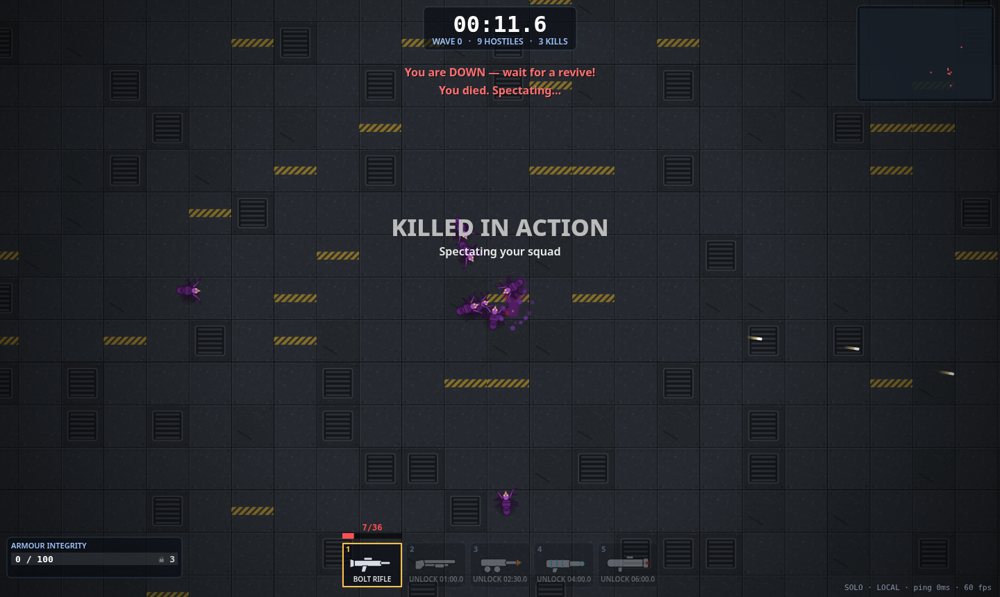
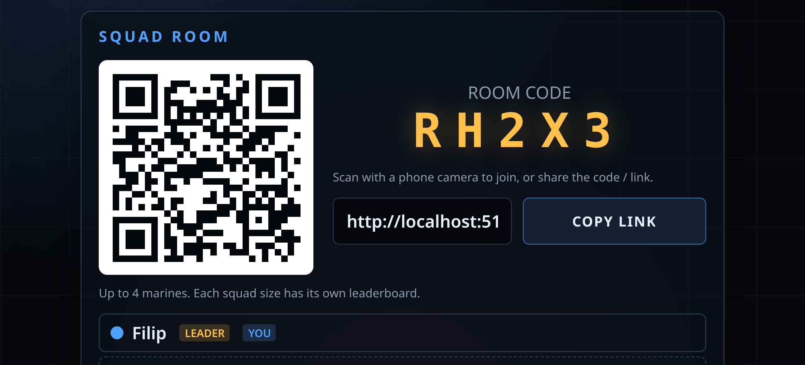
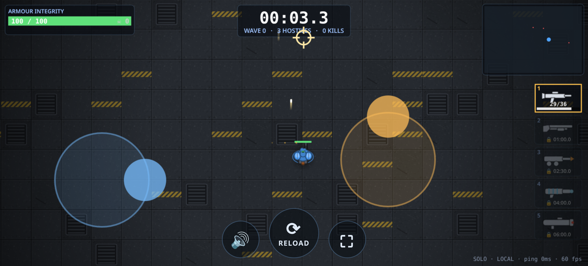

# Space Marine Survival

Top-down co-op swarm survival for the browser. You play a space marine holding out against
endless Tyranid/Zerg-like swarms. The swarm keeps growing, new weapons unlock over time, and
**survival time is the only score**. Teams of **1-4 marines** play together, and each team size
has its **own highscore table**.

**Play it:** https://fafa87.github.io/spacecraft/ (static GitHub Pages build: local highscores,
P2P co-op through the public PeerJS broker).



> v1 / foundation release. The aim is a codebase that is easy to extend: data-driven content,
> a deterministic shared simulation, transport-agnostic netcode, a real highscore server, and a
> procedural asset pipeline for graphics, SFX and music.

## Quick start

Requirements: Node ≥ 20 and npm ≥ 10.

```bash
npm install
npm run assets      # generate sprites/atlas, SFX, music + manifest (also runs before dev/build)
npm run dev         # highscore server + Vite client (see ports below)
```

Then open **http://localhost:5173**, enter a name and choose **Solo**, **Host co-op** or **Join**.

| Service                      | URL / port                                          | What it does                                      |
| ---------------------------- | --------------------------------------------------- | ------------------------------------------------- |
| Client (Vite)                | http://localhost:5173                               | The game                                          |
| Highscore API (Fastify)      | http://localhost:8787/api                           | `/api/highscores`, `/api/health`, `/api/config`   |
| PeerJS signaling             | :9000 at `/peerjs`                                  | WebRTC matchmaking for P2P co-op                  |
| Dedicated WS host (optional) | ws://localhost:8787/ws                              | Server-hosted rooms (`?ws=1` in the client)       |
| Asset preview                | http://localhost:5173/assets/generated/preview.html | Contact sheet of every generated sprite and sound |

### Controls

The client detects the input device by itself. A touch puts it in touch mode, and mouse
movement or a key press puts it back in keyboard/mouse mode, so a touchscreen laptop works both
ways. The PC controls are unchanged.

**PC (keyboard + mouse)**

- **WASD / arrow keys:** move.
- **Mouse:** aim.
- **Left mouse button:** fire.
- **R:** reload.
- **1-9, mouse wheel or Q/E:** switch weapon.
- **M:** mute.
- **Revive:** stand next to a downed teammate for 3 seconds.

**Phone / tablet (standard twin-stick)**

- **Left half of the screen:** a floating **move stick**. It appears where your thumb lands and
  follows it if you drag past the edge. The deadzone is 12% and the speed is analog.
- **Right half of the screen:** a floating **aim stick**. It aims in the direction you push
  and **auto-fires** once it is past a 20% deadzone. Let go to stop firing. While you only move,
  the marine faces the way it is walking.
- **Weapon slots** (right edge): tap an unlocked slot to switch to it.
- **Bottom buttons:** ⟳ reload (large), 🔊 mute and ⛶ fullscreen (fullscreen also locks
  landscape where the browser allows it).
- **Multi-touch** works: move, aim and tap buttons at the same time. Page scroll, pinch-zoom,
  pull-to-refresh and long-press menus are disabled in game.
- **Orientation:** landscape is recommended. In portrait a small "rotate" hint appears, but the
  game stays playable. The HUD scales down on small screens and respects notches and safe areas.

### Joining from a phone (QR code)

The co-op lobby (**Host co-op**) shows a **QR code**, the room code, the join link and a
**Copy link** button. Scanning the QR opens `<site>/?join=CODE`, which goes straight to a short
join screen. That screen only asks for a callsign, which is prefilled from your last visit. If
the join fails, the error is shown on that screen so you can retry.
The link respects the deploy base path (e.g. `/spacecraft/`) and keeps `?ws=1` / `?api=`.

**Testing on a phone over LAN in dev:** the QR uses the address the _host_ browser was opened
with, so do not open the host on `localhost`.

`npm run dev` already serves the client on all interfaces (`vite --host 0.0.0.0`; for a plain
Vite setup this is `vite --host`). Open `http://<your-LAN-IP>:5173` on the PC (e.g. `http://192.168.1.20:5173`) and host a room,
then scan the QR with a phone on the same Wi-Fi. For P2P co-op in dev, the PeerJS signaling
server (:9000) must also be reachable from the phone. The deployed GitHub Pages build uses the
public PeerJS cloud, so it needs nothing extra.

### Client URL parameters

- `?api=http://host:8787` overrides the highscore server.
- `?join=CODE` opens the quick-join screen for that room (this is what the lobby QR encodes).
- `?ws=1` uses the dedicated WebSocket host instead of P2P.
- `?debug=1` (or F3 in game) shows the net/debug overlay.
- `?autosolo=1&name=X` starts a solo run straight away (used by the smoke test).

## Commands

| Command                               | Description                                                                                                                                    |
| ------------------------------------- | ---------------------------------------------------------------------------------------------------------------------------------------------- |
| `npm run dev`                         | Runs the server (tsx watch) and client (Vite) together, after `assets`.                                                                        |
| `npm run assets`                      | Procedural asset generation → `packages/client/public/assets/generated/`.                                                                      |
| `npm test`                            | Vitest (shared sim/session/validation, server API + repos, client netcode/highscore stores, tools).                                            |
| `npm run lint` / `npm run format`     | ESLint (typescript-eslint) / Prettier.                                                                                                         |
| `npm run typecheck`                   | `tsc` for every package.                                                                                                                       |
| `npm run build`                       | Typecheck, then server bundle (`tsup` → `packages/server/dist`) and client bundle (`vite` → `packages/client/dist`).                           |
| `npm start`                           | Runs the built server.                                                                                                                         |
| `npm run smoke`                       | Headless end-to-end check: real server, two WS clients, server-side run submit, POST/GET highscores, a full headless solo run.                 |
| `npm run smoke:browser`               | Headless Chrome against the running Vite client: menu, solo run, host submit to its own in-memory API, P2P + WS co-op, screenshots in `docs/`. |
| `npm run sim -- --bot=kite --seeds=6` | Headless balance simulation: bot survival statistics per team size.                                                                            |

### Server configuration (env vars)

| Var                                            | Default                         |                                                             |
| ---------------------------------------------- | ------------------------------- | ----------------------------------------------------------- |
| `HOST` / `PORT`                                | `0.0.0.0` / `8787`              | HTTP listen address                                         |
| `HIGHSCORE_STORE`                              | `sqlite`                        | `sqlite` (sql.js/WASM, no native build), `json` or `memory` |
| `DATA_DIR`                                     | `./data` (in `packages/server`) | Where `highscores.sqlite` / `highscores.json` live          |
| `CORS_ORIGIN`                                  | `*`                             | Comma-separated list of allowed origins                     |
| `SUBMIT_RATE_PER_MINUTE`                       | `20`                            | POSTs per IP per minute (0 = unlimited)                     |
| `PEER_PORT` / `PEER_PATH` / `PEER_PUBLIC_HOST` | `9000` / `/peerjs` / page host  | Bundled PeerJS server (`PEER_PORT=0` disables it)           |
| `WS_GAME_HOST`                                 | `true`                          | Enables the dedicated WebSocket game host at `/ws`          |
| `LOG_LEVEL`                                    | `info`                          | pino level, or `silent`                                     |

Client build-time env:

| Variable                                                                    | Default                                                 | Meaning                                                                                                                     |
| --------------------------------------------------------------------------- | ------------------------------------------------------- | --------------------------------------------------------------------------------------------------------------------------- |
| `BASE_PATH`                                                                 | `/`                                                     | Public base path (Vite `base`), e.g. `/spacecraft/` for GitHub Pages                                                        |
| `VITE_HIGHSCORE_URL`                                                        | dev: `http://<page host>:8787`; prod: none              | Highscore server. With none set, a production build uses local (browser) highscores quietly and hides the dedicated WS host |
| `VITE_PEER_HOST` / `VITE_PEER_PORT` / `VITE_PEER_PATH` / `VITE_PEER_SECURE` | dev: local server via `/api/config`; prod: PeerJS cloud | PeerJS signaling server                                                                                                     |

## Deploying the client (GitHub Pages)

`.github/workflows/pages.yml` runs on every push to `master`: `npm ci`, `npm run assets`, `npm test`,
then builds the client with `BASE_PATH=/<repo>/` and publishes `packages/client/dist` with
`actions/deploy-pages`. Pages must be set to "GitHub Actions" as its source
(`gh api -X POST repos/<owner>/<repo>/pages -f build_type=workflow`). To use a hosted highscore
server later, set the repository variable `HIGHSCORE_URL`; the server's `CORS_ORIGIN` must allow
`https://<owner>.github.io`.

Locally: `npm run build:pages` builds with `/spacecraft/`, and
`npx tsx scripts/pages-check.ts <url> [screenshot.png]` checks a deployed or served build in headless
Chrome (menu, assets under the base path, local scores, P2P room via PeerJS cloud, a solo run, no
console errors).

## Repository layout

```
packages/
  shared/   @sms/shared: everything both sides must agree on (no DOM, no Node APIs)
    src/data/        content tables: weapons.ts, enemies.ts, director.ts (+ ContentRegistry & validation)
    src/sim/         deterministic simulation: world, systems/ (movement, weapons, projectiles,
                     enemies, director, combat, pickups, players), snapshot builder, spatial hash
    src/session/     HostSession (authoritative lobby + game loop), ClientSession, Scheduler
    src/net/         wire protocol, codec, Link abstraction + in-memory LocalLink pair
    src/highscore/   RunResult/HighscoreEntry types, validation & plausibility checks
    src/assets/      asset manifest format + referencedAssetKeys(content)
  server/   @sms/server: Fastify highscore API, highscore repositories, PeerJS server, WS game host
  client/   @sms/client: Vite + Canvas2D (app/, game/, net/, render/, audio/, ui/, highscores/)
tools/      @sms/tools: procedural sprites → atlas, sfxr-style SFX, chiptune music, manifest, preview
scripts/    smoke.ts, browser-smoke.ts, balance-sim.ts
docs/       ARCHITECTURE.md, ADDING_CONTENT.md, screenshots
```

See **[docs/ARCHITECTURE.md](docs/ARCHITECTURE.md)** for the design in depth and
**[docs/ADDING_CONTENT.md](docs/ADDING_CONTENT.md)** for step-by-step guides to adding a weapon,
an enemy, a sprite, a sound or a music track.

## How multiplayer works

- **Host-authoritative, transport-agnostic.**
  - One `HostSession` runs the simulation at a fixed **30 Hz**. It owns the lobby, applies the
    players' inputs, broadcasts snapshots and submits the result.
  - Clients are `ClientSession`s and only send inputs.
  - Both talk through a tiny `Link` interface, so the same code runs over:
    - **LocalLink** (in-memory) for **solo**: the browser is host and client.
    - **PeerJS / WebRTC data channels** for **P2P co-op** (the default). The player who
      clicks _Host_ runs the `HostSession` in their tab and gets a 5-letter room code; the other
      players _Join_ with it. Signaling uses the bundled PeerJS server on :9000.
    - **WebSocket** to the **dedicated host** in the server (optional, `?ws=1`). The server
      runs the `HostSession`, which is the basis for server-authoritative anti-cheat.
- **Client prediction and reconciliation.** The local marine's movement is predicted with the
  same pure `stepPlayerMovement` the host uses. Unacknowledged inputs are replayed on each
  snapshot, and small errors are smoothed away.
- **Interpolation.** Other entities are rendered about 2.5 ticks behind, from a `SnapshotBuffer`
  with a smoothed clock offset.
- **Team size** is the number of marines at the start of the run, and decides the highscore table.
  Downed marines can be revived; the run ends when no marine is left standing.

## How highscores work

1. When a run ends, **only the host** builds a `RunResult`:
   `{ runId, teamSize, players[], survivalMs, kills, wave, endedAt, version, mode }`.
   Every client is told the outcome (`submitted` message → "rank #N on the global leaderboard").
2. The browser host POSTs it to `POST /api/highscores` through `FallbackHighscoreStore`:
   - Success: `201 { entry, rank, duplicate:false }`. `runId` is idempotent, so a re-submit
     returns `200 duplicate:true`.
   - **Server unreachable**: the run is saved in **localStorage** (status `local`) and
     re-submitted automatically the next time the server answers.
   - **Server rejects it** (4xx): reported as `failed`, so the run never pretends to have counted.
   - With the dedicated WS host, the **server itself** submits straight to the repository.
3. `GET /api/highscores?limit=10` returns all four tables. `GET /api/highscores/:teamSize?limit=N`
   (or `?teamSize=N`) returns one table, ordered by survival time (desc), earlier submission wins
   ties. `limit` is clamped to 1-100.
4. Storage goes through the `HighscoreRepository` interface (`memory`, `json` and `sqlite`
   implementations; add Postgres etc. by implementing 5 methods).
5. **Validation and limits** (shared `validateRunResult`, also run by the client before sending):
   - team size 1-4, and `players.length === teamSize`;
   - names sanitized to 1-16 characters, with control characters and `<>` stripped;
   - survival between 1 s and 4 h; `runId` pattern; mode whitelist; no future `endedAt`;
   - plausibility caps on kills per second per marine and on the wave number for the time
     survived;
   - 4 KB body limit, per-IP fixed-window rate limit (429), configurable CORS.

### Anti-cheat roadmap

Today the score is **trusted from the host browser**: validation only rejects nonsense and
implausible values, and a modified client can still submit a fake but plausible score. Planned
steps, roughly in order:

1. **Signed run tickets:** the server issues a `runId` + nonce at run start (`POST /api/runs`) and
   rejects submissions without a matching ticket, or whose duration disagrees with server
   wall-clock time.
2. **Server-authoritative runs:** the dedicated WS host already runs the same `HostSession`;
   mark scores from it as _verified_ and show them in their own table or with a badge.
3. **Replay verification:** the sim is deterministic (seeded `Rng` and fixed tick), so the host
   can upload `seed + input log` and the server re-simulates headless to confirm the result.
4. Account / identity (OAuth) plus moderation tools (shadow-ban, delete entry), and rate limits
   in Redis once the server scales past one instance.

## Asset pipeline

`npm run assets` (tools/src/generate.ts) writes the following to
`packages/client/public/assets/generated/` (gitignored, always regenerated):

- `atlas.png`: 45 procedurally drawn sprites (76 frames), drawn with `@napi-rs/canvas` and
  shelf-packed into a 1024×512 atlas. They cover the marine (4 team colours plus a downed pose),
  4 enemy types, projectiles, crates and weapon icons, floor tiles, decals and FX.
- `sfx/*.wav`: 19 sound effects from a seeded **sfxr-style synthesizer** with layered presets.
- `music/*.wav`: 3 tracks (`menu`, `battle`, `gameover`) from a small **chiptune sequencer**
  (scale, chord progression, bass, arpeggio, lead and drums; seeded and deterministic).
- `manifest.json`: the frame rects, anchors, volumes, voice limits and durations the client
  loads.
- `preview.html`: a contact sheet to look at and listen to every asset.

Every sprite carries a text **`prompt`**, which serves as a ready-made brief for AI/hand-made
art. Dropping a file into `tools/assets-src/overrides/{sprites,sfx,music}/<key>.(png|wav)`
replaces the procedural version on the next run. The generator also checks **coverage**: every
sprite or sound referenced by the content data must exist, otherwise it fails. The same check
runs in a unit test.

## Testing

- `npm test`: 84 unit/integration tests.
  - Shared: rng, movement, swept projectile collision, determinism, director escalation,
    revive and game over, content and highscore validation, and a full HostSession over local
    links with a ManualScheduler.
  - Server: API via `app.inject` (201/200/400/413/429, ordering, separate tables, CORS) and
    json/sqlite persistence across restarts.
  - Client: Predictor, SnapshotBuffer, Local/Fallback highscore stores, the joystick/deadzone
    math, touch intents and input merging, and join-URL building and parsing with a QR encode →
    decode round trip.
  - Tools: asset coverage, packer overlap, WAV round-trip and song length.
- `npm run smoke`: headless, starts its own in-memory server on a random port.
- `npm run smoke:browser`: needs `npm run dev` (for the Vite client) and Chrome at
  `/usr/bin/google-chrome` (or `CHROME_PATH`). It boots its **own in-memory API + PeerJS**
  (ports 8797/9007), so it never touches the real leaderboard. It saves `docs/menu.png`,
  `docs/screenshot.png`, `docs/gameover.png` and `docs/screenshot-coop-*.png`. Set
  `STRICT_P2P=1` to make a blocked WebRTC data channel fatal.
- `npm run check:mobile [clientUrl]`: headless mobile emulation (iPhone 14 and Pixel 5
  landscape, touch, via CDP multi-touch) against a running client (default
  `http://localhost:5173/`). It checks the responsive menu and the lobby QR (decoded with jsQR,
  it must equal the join link). It opens the decoded `?join=` link in a second "phone" and checks
  the quick-join screen. In a solo run it drives the twin sticks (move, aim + auto-fire,
  independent release), reload and a weapon-slot tap, and checks the portrait hint. It also
  checks that desktop mouse/keyboard still behave as before. It saves `docs/mobile-lobby-qr.png`
  and `docs/mobile-gameplay.png`.




## Roadmap

- **Netcode:**
  - Run the browser host in a Web Worker, so a backgrounded host tab is not throttled.
  - Binary snapshot codec with delta compression, and an unreliable/unordered data channel for
    snapshots.
  - TURN server config for strict NATs.
  - Host migration.
- **Gameplay:**
  - More enemy types: burrowers, flyers, a broodmother boss with spawns.
  - Perks/upgrades between surges, grenades, turrets, a melee/dash.
  - Obstacles and maps (the arena is open floor today).
- **Balance:** tune with `npm run sim` (bots survive about 1-3 min today; humans who kite and
  revive do better).
- **Assets:** an AI-art workflow through the override folder, animation states, a music
  intensity layer tied to the director, and spatial audio.
- **Platform:**
  - Anti-cheat steps (above), accounts, seasons/weekly tables.
  - Postgres repository, Docker image, CI (lint + test + smoke).
